<p align="center">
  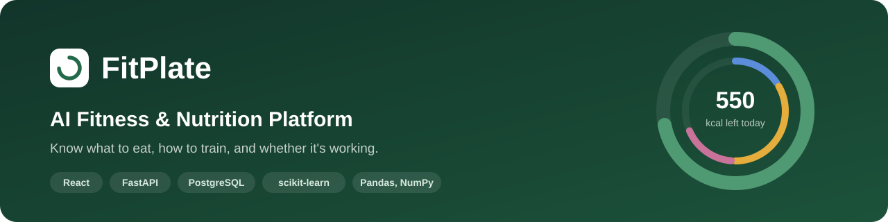
</p>

<p align="center">
  <a href="https://github.com/Maheshdasi/FitPlate/actions/workflows/tests.yml"></a>
  
  
  
  
  
  
  
  <a href="LICENSE"></a>
</p>

<p align="center">
  <a href="https://fitplate-0xeo.onrender.com"></a>
</p>

<p align="center">
  <a href="https://fitplate-0xeo.onrender.com"><b>Live demo</b></a> |
  <a href="#try-it-yourself"><b>Try it</b></a> |
  <a href="#how-it-works"><b>How it works</b></a> |
  <a href="#results"><b>Results</b></a> |
  <a href="docs/ARCHITECTURE.md"><b>Architecture</b></a> |
  <a href="docs/PROJECT_REPORT.md"><b>Project report</b></a>
</p>

**FitPlate** is a full-stack web application that brings fitness, nutrition, workouts and progress tracking into one place.
It turns a user's profile into daily calorie and protein targets, suggests meals and workouts that fit those targets,
tracks what they eat and how they train, and explains each week back to them in plain language.

Unlike most fitness apps, FitPlate **shows where every number comes from**. Calorie targets use published formulas,
safety decisions use clear rules, and recommendations use machine learning, and the app labels which is which.
It is built around **everyday Indian meals** such as dal, roti, idli, paneer and curd.

<p align="center">
  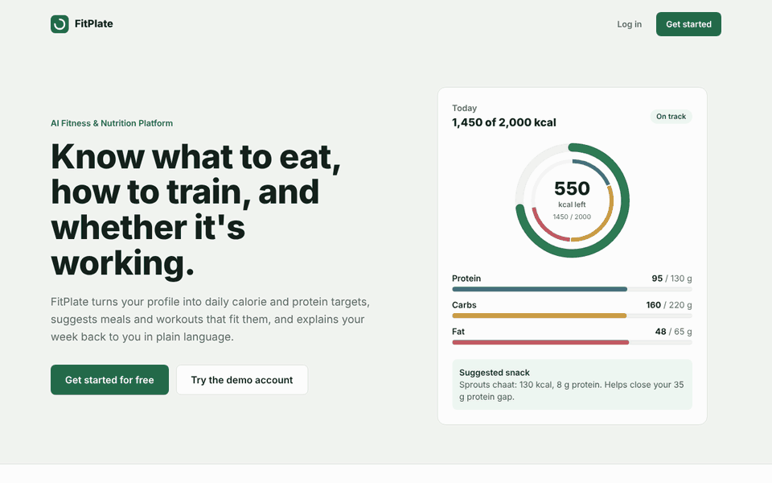
</p>

## Highlights

| | |
|---|---|
| **Explainable targets** | BMI, BMR, TDEE, calories and macros from the Mifflin-St Jeor equation, with every step shown to the user |
| **Safe recommendations** | Diet type and allergies are enforced by rules before any ML ranking: **0 violations in 384 tested scenarios** |
| **Five ML techniques** | Content-based filtering, similarity ranking with MMR, linear regression, K-Means clustering and a text classifier |
| **Weekly review in plain words** | "You stayed close to your calorie target on 5 out of 7 days", followed by practical suggestions |
| **AI assistant** | Answers any question with a real AI model (Llama, Gemini or Claude) that sees the user's own data; works offline too |
| **Tested and secure** | 108 automated tests, 94% coverage, linting on every update, bcrypt passwords, JWT login, ORM-only database access |

## Contents

- [The problem](#the-problem)
- [What FitPlate does](#what-fitplate-does)
- [Screenshots](#screenshots)
- [How it works](#how-it-works)
- [Results](#results)
- [Data, security and quality](#data-security-and-quality)
- [Technology and project structure](#technology-and-project-structure)
- [Try it yourself](#try-it-yourself)
- [Documentation](#documentation)

## The problem

People who want to lose weight, build muscle or simply stay fit usually juggle several separate tools: a calorie calculator,
a food-logging app, a workout app and a notebook for their weight. These tools don't share data, so the user has to work
out for themselves what to eat next, whether today's workout fits their goal, and whether their habits are working.
Popular food databases focus on packaged Western foods, and many "smart" apps never explain where their numbers come from.

## What FitPlate does

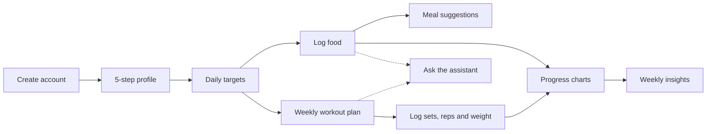

1. **Profile**: age, gender, height, weight, target weight, activity level, goal, diet type (vegetarian, non-vegetarian,
   vegan, eggetarian), allergies, workout level, free days per week and where they train.
2. **Daily targets**: BMI, BMR, TDEE, calories, protein, carbohydrates, fat and water, each step explained.
3. **Food tracker**: search 79 foods and log them in the unit you use: servings, grams, ounces, katori, cups,
   ml, glasses, tablespoons, teaspoons or pieces, whichever suits the food. Totals and charts update instantly.
4. **Meal suggestions** for breakfast, lunch, dinner and snacks, sized to what is left today, with ingredients,
   preparation steps, a match score and the reasons each meal was chosen.
5. **Workout plan** matched to the goal, level, equipment and free days, with sets, reps, rest and difficulty.
   Pick a training split (push pull legs, bro split, upper / lower, Arnold, full body) or build your own days.
   The workout tracker logs every set (kg and reps, or time) like Hevy: last session's numbers are shown, the next
   target is suggested by double progression, a rest timer starts after each set, and personal records are marked.
6. **Progress** over 7 days, 30 days, 3 months or 6 months: weight with a forecast trend line, body measurements,
   calories and protein against goals, water and workout consistency.
7. **Weekly insights** in plain sentences, practical suggestions and a habit pattern for the week.
8. **AI assistant** that answers anything, from "What should I eat for dinner?" to "Is creatine safe?" or a recipe,
   using the user's targets, food log and workout plan. Add a free Groq or Gemini key; without one it works offline.

## Screenshots

| | |
|---|---|
| 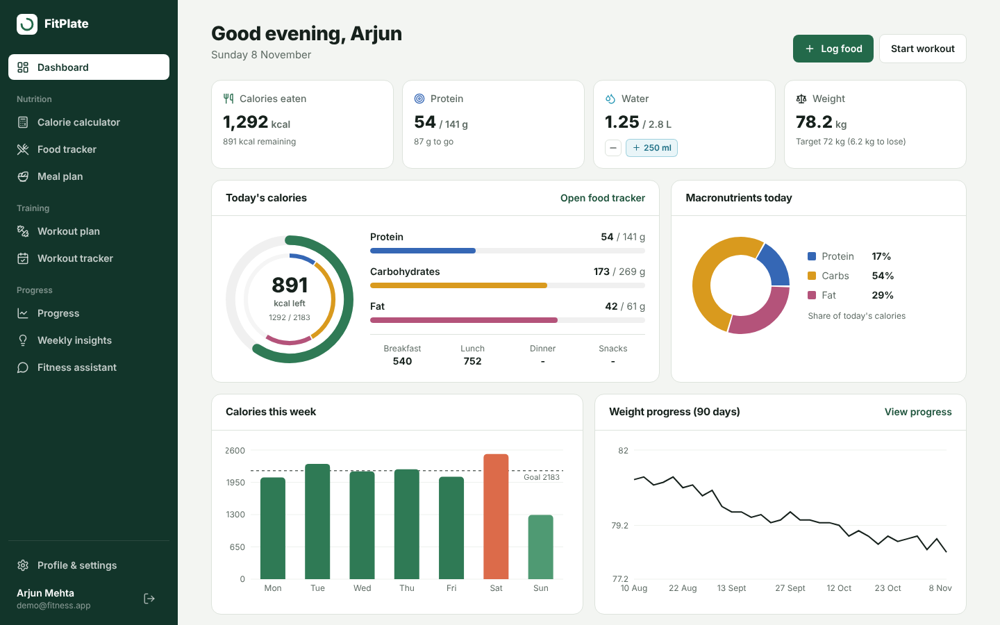 | 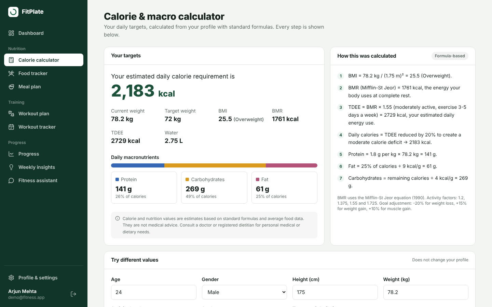 |
| **Dashboard**: today's calories, macros, water, weight and charts | **Calculator**: targets with every step shown |
| 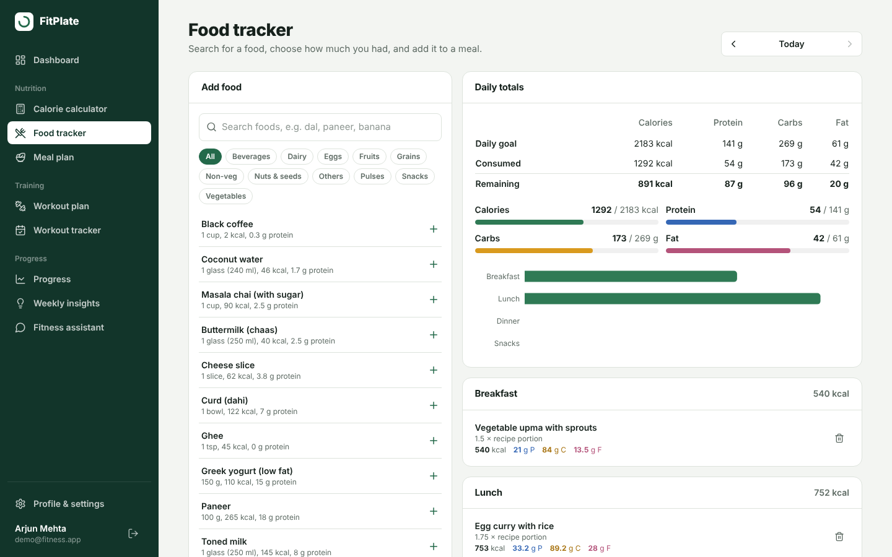 | 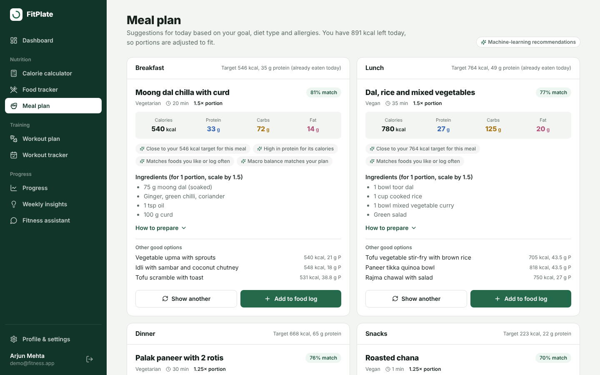 |
| **Food tracker**: search, log and daily totals | **Meal plan**: ranked meals with reasons |
| 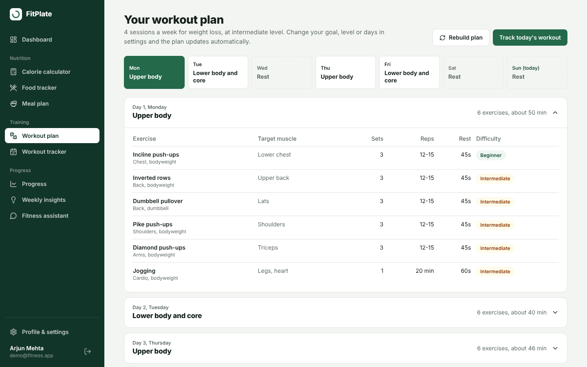 | 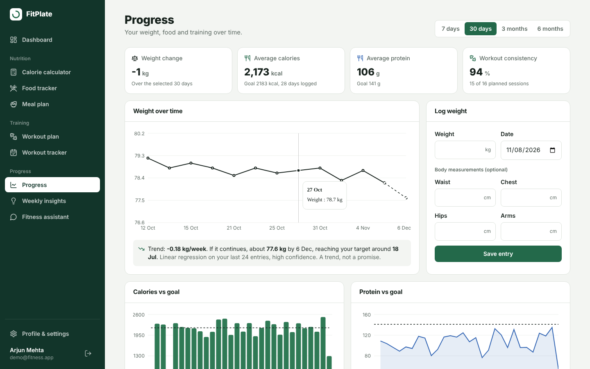 |
| **Workout plan**: weekly schedule and exercises | **Progress**: trends and a weight forecast |
| 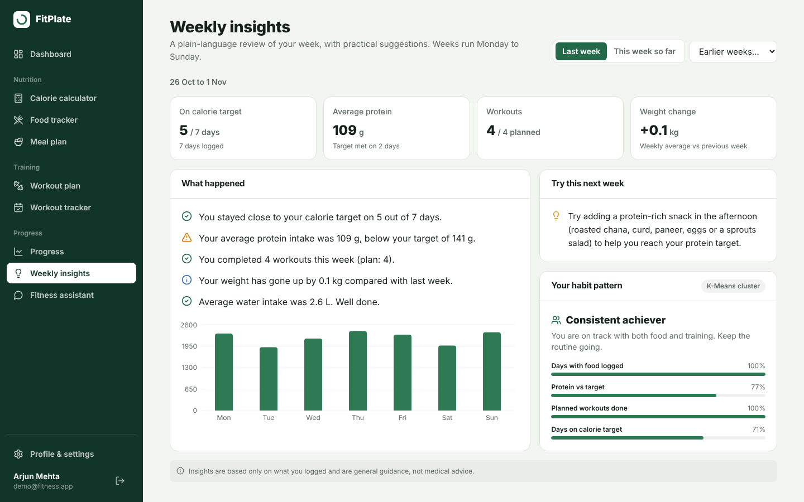 | 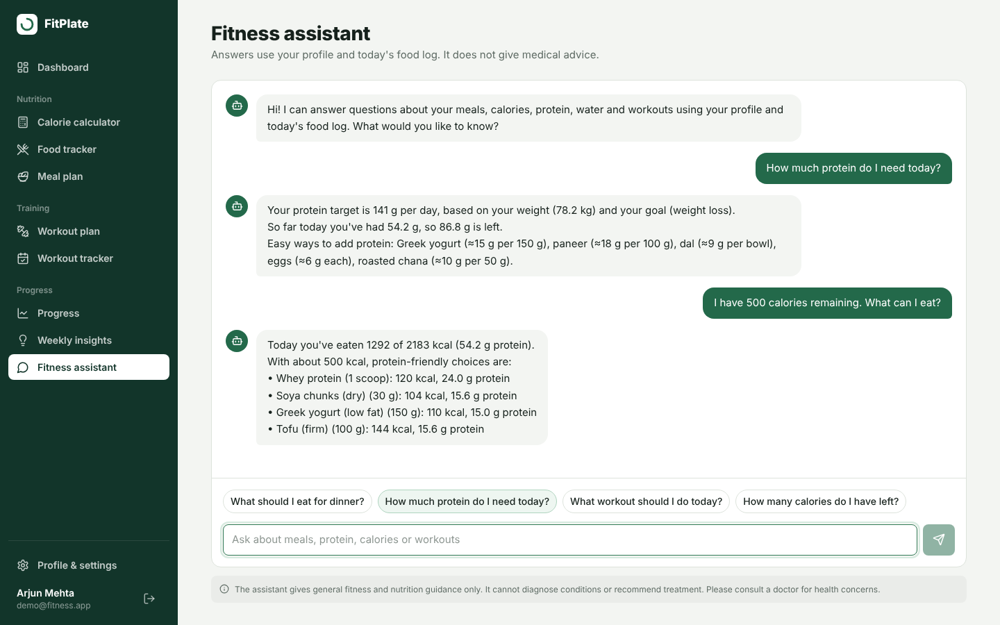 |
| **Weekly insights**: review, suggestions, habit pattern | **Assistant**: answers from the user's own data |

<p align="center">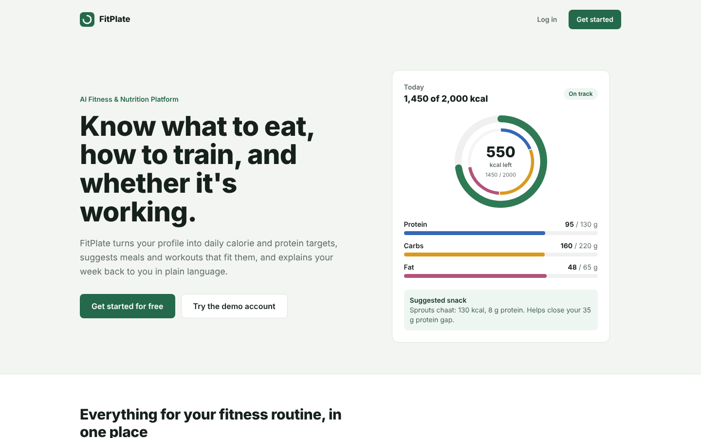&nbsp;&nbsp;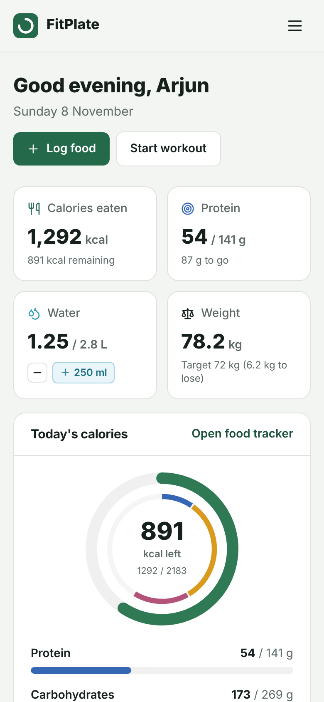<br><sub>Landing page, and the same dashboard on a phone</sub></p>

## How it works

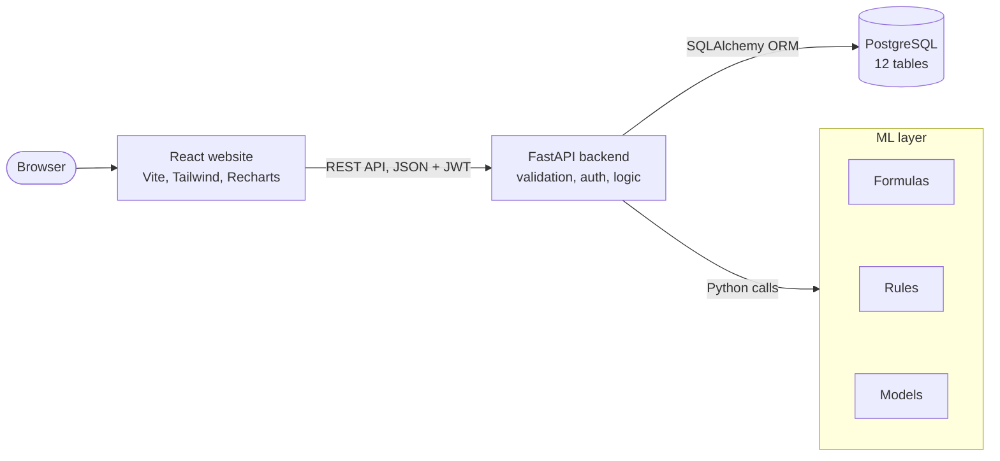

The React website talks to a FastAPI backend through a REST API. The backend validates every input, checks the login
token, stores data in PostgreSQL and calls the ML layer, which is plain Python with no web code so each part can be
tested on its own. More diagrams, including the database design and a step-by-step recommendation flow, are in
[docs/ARCHITECTURE.md](docs/ARCHITECTURE.md).

### Formulas, rules and machine learning

| Part of the app | Type | Technique |
|---|---|---|
| BMI, BMR, TDEE, calories, protein, carbs, fat, water | Formula | WHO BMI, Mifflin-St Jeor, activity factors, goal adjustment |
| Removing meals that break the diet type or contain allergens | Rule | Hard safety filter, applied before any ML |
| Weekly workout split; sets, reps and rest | Rule | Strength-training guidelines by goal and level |
| Ranking meals | ML | Content-based filtering with TF-IDF and cosine similarity |
| Choosing exercises | ML | Cosine similarity with Maximal Marginal Relevance (MMR) |
| Weight trend and target date | ML | Linear regression |
| Habit pattern in the weekly review | ML | K-Means clustering |
| Weekly statistics and suggestions | Analysis + rules | Pandas aggregation with threshold rules |
| Understanding assistant questions | ML | Character n-gram TF-IDF with logistic regression |

<details>
<summary><b>Calorie and macro targets</b> (formula-based)</summary>

```
BMI      = weight (kg) / height (m)²
BMR      = 10 × weight + 6.25 × height (cm) - 5 × age + 5     (men; -161 for women)
TDEE     = BMR × activity factor (1.2 to 1.725)
Calories = TDEE adjusted for the goal (-20% weight loss, +15% weight gain, +10% muscle gain)
Protein  = 1.4 to 2.0 g per kg of body weight, depending on the goal
Fat      = 25% of calories, and carbohydrates fill the remaining calories
```

The calculator page shows each of these steps with the user's own numbers and a medical disclaimer.
</details>

<details>
<summary><b>Meal recommendations</b> (content-based filtering)</summary>

1. **Filter**: meals outside the user's diet type or containing their allergens are removed.
2. **Target**: the calories and protein left today are shared across the meals not yet eaten.
3. **Score** each meal: how closely its protein, carbs and fat split matches the target (cosine similarity), how close
   its calories are, how similar its ingredients are to foods the user likes and logs often (TF-IDF), and protein per calorie.
4. **Portion**: the serving is scaled between 0.75× and 1.5× to land near the target.

"Show another" returns the next-best meal not yet shown. The more a user logs, the more personal the suggestions become.
</details>

<details>
<summary><b>Workout recommendations</b> (rules + similarity)</summary>

The user picks a split (push pull legs, bro split, upper / lower, Arnold, full body, or their own custom days with the
muscle groups they choose). On "Recommended", the number of free days sets the split (for example, 4 days gives upper
and lower body sessions twice). The
goal and level set sets, reps and rest. Each exercise is described by its features (difficulty, equipment, strength or
cardio, compound movement, goals it suits); the user is described the same way, and exercises are ranked by cosine
similarity. Maximal Marginal Relevance then picks a varied session so the same muscle isn't trained twice in a row.
</details>

<details>
<summary><b>Progress, weekly insights and the assistant</b></summary>

- **Weight trend**: linear regression on recent weight entries gives the weekly change, a 4-week forecast and an
  estimated date to reach the target weight.
- **Weekly insights**: Pandas summarises the week, rules turn it into sentences and suggestions, and K-Means places the
  week into a habit pattern such as "Consistent achiever" or "Getting started".
- **Assistant**: with an API key (free from Groq or Google Gemini, or Claude), a large language model answers any question
  like a search engine and AI assistant would. It is given the user's profile, targets, today's food log, workout plan,
  weight trend and the app's own meal suggestions, plus the conversation so far, so answers are personal and follow-ups
  work. Gemini can also search Google and show its sources. Questions asking for medicines, doses or a diagnosis are
  declined by a safety rule before anything is sent. Without a key, or if the service is down, the offline assistant
  answers instead: a classifier works out what is being asked and the answer is built from the same data. It remembers
  the conversation too, so "I don't have peanut butter" or "something else" changes the suggestion.
</details>

Full details of every formula, rule and model: [docs/ML_AND_ALGORITHMS.md](docs/ML_AND_ALGORITHMS.md)

## Results

| Component | Evaluation | Result |
|---|---|---|
| Meal recommender safety | 384 scenarios (4 diets × 6 allergy sets × 4 goals × 4 meals) | **0** diet or allergy violations |
| Meal recommender fit | Gap between the top meal and the meal's calorie target | median **3.1%**, **98%** within 15% |
| Assistant intent classifier | 5-fold cross-validation, 75 examples, 8 intents | **80%** accuracy |
| Assistant intent classifier | 8 misspelt questions it has never seen ("what shud i eat for dinr") | **8 / 8** correct |
| Behaviour clustering | Silhouette score, K-Means with 4 clusters | **0.55** |
| Calorie targets | Compared with hand calculations | exact match |

Reproduce these numbers with `python -m ml.evaluate`. They are also recomputed automatically on every update.

## Data, security and quality

**Data**
- **79 foods**, mostly Indian staples, with calories, protein, carbs, fat, fibre, diet type and allergens per serving.
- **49 meals** with ingredients, preparation steps and macros, and **72 exercises** across 8 muscle groups.
- **A demo account** with four months of food, water, weight, measurement and workout history, so every chart has data
  from the first login.

**Security**
- Passwords hashed with bcrypt; login with expiring JWT tokens; users can only see and change their own records.
- Every input validated (ranges, allowed values, email, password strength, no future dates).
- All database access through the SQLAlchemy ORM, which prevents SQL injection; secrets kept in environment variables.

**Quality**
- **108 automated tests**: 62 API, security and integration tests, and 46 unit tests for the ML layer.
- **94% code coverage** of the backend and ML layer, linting with ruff, and a production build of the website.
- All of this runs on [GitHub Actions](https://github.com/Maheshdasi/FitPlate/actions) on every update.

## Technology and project structure

| Layer | Technology |
|---|---|
| Frontend | React 18, Vite, Tailwind CSS, Recharts, React Router |
| Backend | Python 3.12, FastAPI, SQLAlchemy 2, Pydantic |
| Database | PostgreSQL (12 tables with constraints and indexes) |
| Authentication | JWT and bcrypt |
| AI / ML | scikit-learn, Pandas, NumPy |
| Testing and CI | pytest, coverage, ruff, GitHub Actions |
| Deployment | Docker, Render blueprint, GitHub Codespaces |

```
FitPlate/
├── frontend/      React website: 14 pages, charts and the API client
├── backend/       FastAPI app: routes, models, validation, security and 108 tests
├── ml/            Formulas, rules, ML models and the evaluation script
├── database/      PostgreSQL schema and the food, meal and exercise datasets
├── docs/          Project report, architecture, algorithms, API reference, setup guide
└── scripts/       One-click setup and start scripts for Windows
```

## Try it yourself

**Live demo: [fitplate-0xeo.onrender.com](https://fitplate-0xeo.onrender.com)**. The free server sleeps when nobody is using it,
so the first visit can take about a minute to load.

**Log in** with the demo account **`demo@fitness.app`** / **`Demo@1234`** (four months of sample history),
or click "Get started" to create a new account.

| Option | Steps |
|---|---|
| **Deploy online** (live link)<br>[](https://render.com/deploy?repo=https://github.com/Maheshdasi/FitPlate) | Click the button, sign in to Render with GitHub and click **Deploy Blueprint**. After 5 to 10 minutes the service is **Live**; open its `onrender.com` link. |
| **Run in the browser**<br>[](https://codespaces.new/Maheshdasi/FitPlate?quickstart=1) | Click the button, then **Create codespace**. A code editor opens and sets everything up (3 to 5 minutes). The app then opens in a new tab; if it doesn't, open the **PORTS** tab and click the globe icon next to port **8000**. |
| **Run on your computer** | Install Python 3.12, Node.js and PostgreSQL. On Windows run `scripts\windows\setup.bat` once, then `scripts\windows\start.bat`. Other systems: [docs/SETUP.md](docs/SETUP.md). |

The API documentation (Swagger) is at `/api/docs` on Render and Codespaces, or `http://localhost:8000/docs` when run locally.

## Documentation

| Document | Contents |
|---|---|
| [Project report](docs/PROJECT_REPORT.md) | Problem statement, literature survey, objectives, existing and proposed system, methodology, testing, results, future scope |
| [Architecture](docs/ARCHITECTURE.md) | System, sequence, user-journey and database diagrams |
| [Algorithms](docs/ML_AND_ALGORITHMS.md) | Every formula, rule and model, with a worked example |
| [API reference](docs/API.md) | All REST endpoints with request and response examples |
| [Database schema](database/schema.sql) | Tables, constraints and indexes |
| [Setup guide](docs/SETUP.md) | Running locally, on Codespaces and on Render |

## Author

**Mahesh Dasi** ([@Maheshdasi](https://github.com/Maheshdasi))
Final-year B.Tech capstone project.

## License and disclaimer

Released under the [MIT License](LICENSE).

Calorie and nutrition values are estimates, and the assistant gives general guidance only.
FitPlate does not provide medical advice, diagnosis or treatment.
