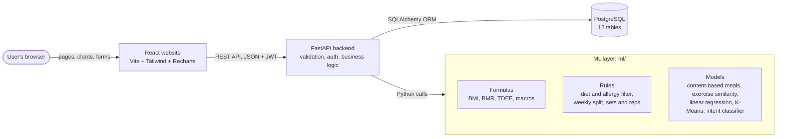
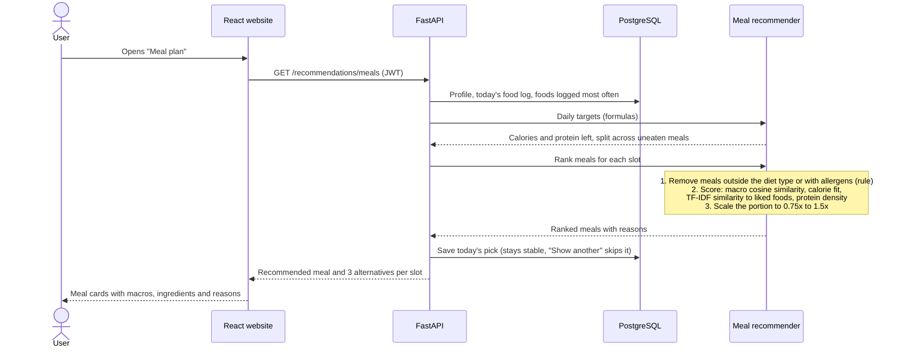
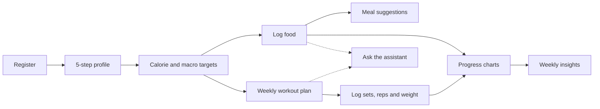
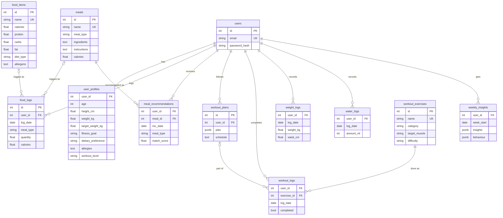

# Architecture

FitPlate has three layers (React website, FastAPI backend, PostgreSQL database) and a separate ML layer that the
backend calls as plain Python functions. The diagrams below are drawn by GitHub from the text in this file.

## System overview

## How a meal recommendation is made

## User journey

## Database

Every table has a `created_at` timestamp, every user-owned row is deleted with its user, and CHECK constraints
guard every range and allowed value. Full DDL: [database/schema.sql](../database/schema.sql).

## Code layout

| Folder | What it contains |
|---|---|
| `frontend/src/pages` | The 14 pages (landing, login, registration, profile setup, dashboard, calculator, food tracker, meal plan, workout plan, workout tracker, progress, weekly insights, assistant, settings) |
| `frontend/src/components` | Sidebar layout, calorie ring, profile form, shared UI pieces |
| `backend/app/routers` | REST endpoints grouped by feature |
| `backend/app/services` | Business logic shared by the endpoints |
| `backend/app/models.py`, `schemas.py` | Database tables and input validation |
| `ml/` | Formulas, rules and models, independent of the web code |
| `backend/tests` | 110 automated tests (API, security and ML) |
