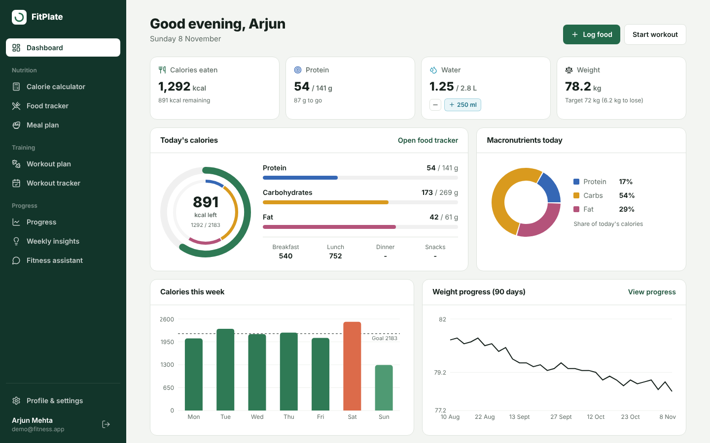
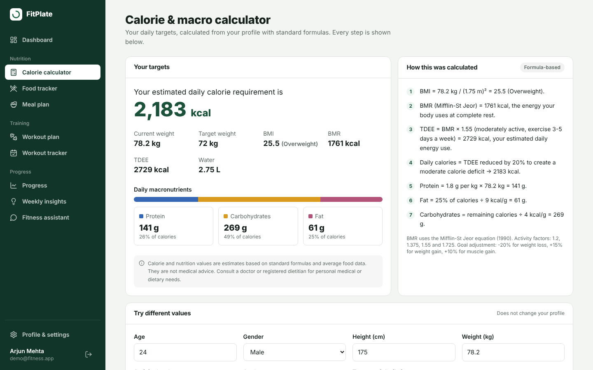
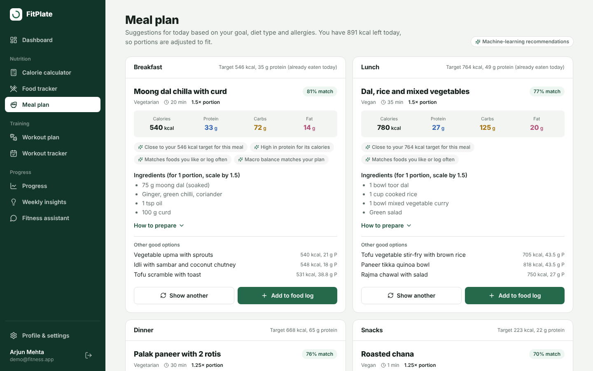
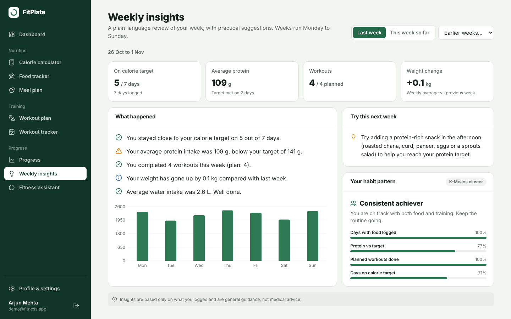

# AI Fitness & Nutrition Platform: Project Report

Final-year B.Tech capstone project.
Detailed algorithm descriptions: [ML_AND_ALGORITHMS.md](ML_AND_ALGORITHMS.md). API reference: [API.md](API.md).

---

## 1. Problem statement

People who want to lose weight, gain muscle or simply stay fit usually juggle several separate tools: a BMI or
calorie calculator, a food-logging app, a workout app and a notebook or spreadsheet for weight. These tools do
not share data, so the user has to work out for themselves what to eat next, whether today's workout fits their
goal, and whether their habits are actually working.

Popular food databases are also built mainly around Western packaged foods, so everyday Indian meals such as
dal, roti, idli, curd rice and paneer dishes are hard to log accurately. Many apps present calorie numbers and
"smart" recommendations without explaining how they were produced, which makes them hard to trust.

**Goal:** build a single web platform that turns a user's profile into explainable daily targets, recommends
meals and workouts that fit those targets and the user's constraints (diet type, allergies, equipment, level),
tracks progress, and summarises each week in plain language, using machine learning only where it adds value,
and clearly separating formulas, rules and ML.

## 2. Literature survey

| # | Work | Relevance to this project |
|---|---|---|
| 1 | Mifflin, M. D., St Jeor, S. T. et al. (1990). *A new predictive equation for resting energy expenditure in healthy individuals.* American Journal of Clinical Nutrition, 51(2), 241-247. | BMR equation used by the calculator. |
| 2 | Harris, J. A. & Benedict, F. G. (1919). *A Biometric Study of Basal Metabolism in Man.* Carnegie Institution. | Earlier BMR equation; Mifflin-St Jeor was chosen as it is generally considered more accurate for modern populations. |
| 3 | World Health Organization. *Body mass index (BMI) classification for adults.* | BMI categories (< 18.5, 18.5 to 24.9, 25 to 29.9, ≥ 30). |
| 4 | Longvah, T. et al. (2017). *Indian Food Composition Tables.* National Institute of Nutrition, Hyderabad. | Reference for nutrient values of Indian foods in the seed dataset (values in the app are rounded averages). |
| 5 | Lops, P., de Gemmis, M. & Semeraro, G. (2011). *Content-based Recommender Systems: State of the Art and Trends.* In Recommender Systems Handbook, Springer. | Basis of the content-based meal recommender (item profiles, user profiles, similarity). |
| 6 | Freyne, J. & Berkovsky, S. (2010). *Intelligent food planning: personalized recipe recommendation.* Proc. IUI 2010. | Recipe recommendation from ingredient-level preferences, similar to using ingredient TF-IDF. |
| 7 | Trattner, C. & Elsweiler, D. (2017). *Investigating the healthiness of internet-sourced recipes.* Proc. WWW 2017. | Motivates ranking by nutritional fit, not only popularity. |
| 8 | Carbonell, J. & Goldstein, J. (1998). *The use of MMR, diversity-based reranking for reordering documents and producing summaries.* Proc. SIGIR 1998. | Maximal Marginal Relevance used to diversify exercises within a session. |
| 9 | MacQueen, J. (1967). *Some methods for classification and analysis of multivariate observations.* Proc. 5th Berkeley Symposium. | K-Means clustering used for behaviour patterns. |
| 10 | Pedregosa, F. et al. (2011). *Scikit-learn: Machine Learning in Python.* JMLR 12, 2825-2830. | Library used for TF-IDF, cosine similarity, K-Means, linear and logistic regression. |

**Summary.** Energy-requirement equations are well established and explainable, so they are better
implemented as formulas than learned. Recommendation research shows content-based methods work well when
there is little user history (the cold-start case for a new user), and diversity re-ranking such as MMR
improves list quality. Unsupervised clustering is a common way to segment behaviour when labels are not available.

## 3. Objectives

1. Provide secure registration and login, and collect a complete fitness profile with validation.
2. Calculate BMI, BMR, TDEE, daily calories and macronutrients with a documented, step-by-step method.
3. Let users log foods and meals by meal type with automatic daily totals, progress bars and charts.
4. Recommend meals that respect diet type and allergies and fit the calories and protein left for the day.
5. Generate a personalised weekly workout plan and let users mark exercises as completed.
6. Track weight, body measurements, calories, protein, water and workout consistency over 7 days to 6 months.
7. Produce weekly insights and practical suggestions without medical claims.
8. Provide an assistant that answers fitness and nutrition questions using the user's own data.
9. Clearly separate formula-based, rule-based and machine-learning components.

## 4. Existing system

Users typically rely on a combination of:

- **Standalone calculators**: give a calorie number but no tracking and often no explanation.
- **General food-logging apps**: large databases, but Indian home-cooked meals often need manual entries; recommendations, if any, are generic.
- **Workout apps**: fixed programmes not linked to nutrition or the user's equipment and available days.
- **Manual records**: spreadsheets or notebooks for weight with no analysis.

**Limitations:** data is spread across tools; targets are not explained; recommendations ignore what the user
already ate today; diet type and allergies are often filters the user must apply manually; there is no
plain-language weekly review.

## 5. Proposed system

One web application where every module reads the same profile and logs:

- The **profile** drives formula-based targets.
- The **food log** updates remaining calories and protein in real time.
- The **meal recommender** uses the targets, today's log, diet, allergies and preferences.
- The **workout recommender** uses goal, level, available days and equipment; completions feed progress.
- **Progress** and **weekly insights** analyse all logs together and suggest one or two practical changes.
- The **assistant** answers questions using all of the above.

**Advantages:** single source of truth, explainable numbers, Indian food coverage, safety constraints
(allergies and no medical advice) applied by rules before any ML ranking, and works offline without paid APIs.

## 6. System architecture

```
┌──────────────────────────────┐
│  React SPA (Vite, Tailwind)  │  14 pages, Recharts, JWT in localStorage
└──────────────┬───────────────┘
               │ HTTPS / JSON, Authorization: Bearer <JWT>
┌──────────────▼───────────────┐
│  FastAPI                     │  routers → services → ORM
│  • auth / profile            │  Pydantic validation, CORS, error handlers
│  • nutrition / food log      │
│  • recommendations / workouts│
│  • progress / dashboard      │
│  • insights / ai             │
└───────┬──────────────┬───────┘
        │              │ Python calls
        │      ┌───────▼────────────────────────────┐
        │      │  ML layer (/ml)                    │
        │      │  calculations (formulas)           │
        │      │  meal_recommender (TF-IDF, cosine) │
        │      │  workout_recommender (cosine, MMR) │
        │      │  progress_predictor (regression)   │
        │      │  behavior_clustering (K-Means)     │
        │      │  weekly_insights (Pandas + rules)  │
        │      │  chat_assistant (LogReg intents)   │
        │      └────────────────────────────────────┘
        │ SQLAlchemy ORM (bound parameters)
┌───────▼──────────────────────┐
│  PostgreSQL (12 tables)      │
└──────────────────────────────┘
```

The ML layer has no web or database code; it receives plain Python data, which makes it independently testable.
Recommender models are built once from the catalogue tables and cached in memory.

## 7. Modules

| Module | Responsibilities | Pages |
|---|---|---|
| Authentication | Register, login, JWT issue/verify, bcrypt hashing, route protection | Login, Registration |
| Profile | 5-step setup wizard, edit, validation, sync weight, rebuild workout plan on change | Profile Setup, Profile / Settings |
| Calculator | BMI, BMR, TDEE, calories, macros, water, explanation, what-if mode, disclaimer | Calorie & Macro Calculator |
| Food tracking | Food search/filter, add with quantity and meal type, delete, daily totals, day navigation | Food Tracker |
| Meal recommendation | Per-slot recommendations, reasons, alternatives, replace, add to log | Meal Recommendations |
| Workout recommendation | Weekly split, exercise ranking, schedule, rebuild | Workout Recommendations |
| Workout tracking | Tick/untick exercises, rest-day handling, history, 14-day view | Workout Tracker |
| Dashboard | Summary cards, calorie ring, macro chart, weekly calories, weight, consistency, today's workout and meal, water | Dashboard |
| Progress | Weight and measurements logging, range selection, five charts, regression forecast | Progress |
| Weekly insights | Weekly analysis, insights, suggestions, behaviour cluster, history | Weekly Insights |
| AI assistant | Safety guard, intent classification, data-driven answers, quick replies | AI Fitness Assistant |
| Landing | Product description, benefits, how it works, methods | Landing Page |

## 8. Database design

Full DDL: [`database/schema.sql`](../database/schema.sql).

```
users 1───1 user_profiles
  │
  ├───< food_logs >─── food_items        (food_item_id, nullable)
  │          └──────── meals             (meal_id, nullable)
  ├───< meal_recommendations >── meals
  ├───< workout_plans
  ├───< workout_logs >── workout_exercises
  │          └──────── workout_plans     (plan_id, nullable)
  ├───< weight_logs
  ├───< water_logs
  └───< weekly_insights
```

| Table | Key columns | Constraints and indexes |
|---|---|---|
| users | id, email, password_hash, is_active, created_at, updated_at | email UNIQUE + index |
| user_profiles | user_id, name, age, gender, height_cm, weight_kg, target_weight_kg, activity_level, fitness_goal, dietary_preference, allergies[], food_preferences, workout_level, workout_days_per_week, preferred_workout_type | user_id UNIQUE FK (cascade); CHECKs on every range and enum |
| food_items | name, category, serving_desc, serving_g, calories, protein, carbs, fat, fiber, diet_type, allergens[] | name UNIQUE; non-negative nutrient CHECK |
| meals | name, meal_type, diet_type, ingredients[], instructions, macros, allergens[], tags[], prep_time_min | meal-type and diet CHECKs; meal_type index |
| food_logs | user_id, food_item_id?, meal_id?, name, serving_desc, meal_type, quantity, log_date, calories, protein, carbs, fat | (user_id, log_date) index; 0 < quantity ≤ 20; nutrient **snapshot** keeps history correct |
| meal_recommendations | user_id, meal_id, rec_date, meal_type, portion, macros, match_score, excluded_meal_ids[], status | UNIQUE (user_id, rec_date, meal_type) |
| workout_exercises | name, category, target_muscle, equipment, difficulty, exercise_type, is_compound, is_timed, default_duration, goal_tags[], instructions | category/difficulty/type CHECKs |
| workout_plans | user_id, is_active, days_per_week, level, goal, schedule[], plan (JSONB) | (user_id, is_active) index |
| workout_logs | user_id, plan_id?, exercise_id, log_date, day_number, sets_completed, completed | UNIQUE (user_id, log_date, exercise_id); (user_id, log_date) index |
| weight_logs | user_id, log_date, weight_kg, waist_cm, chest_cm, hips_cm, arms_cm | UNIQUE (user_id, log_date); weight range CHECK |
| water_logs | user_id, log_date, amount_ml | (user_id, log_date) index; 0 < amount ≤ 3000 |
| weekly_insights | user_id, week_start, week_end, metrics, insights, suggestions, behaviour, daily (JSONB) | UNIQUE (user_id, week_start) |

All tables have `created_at`; all user-owned rows cascade on user deletion.

## 9. Methodology

An iterative, module-by-module approach was followed:

1. **Requirements**: features and constraints from the problem statement; user workflow defined as
   registration → profile → targets → food → recommendations → workouts → progress → insights.
2. **Data preparation**: three curated datasets covering 79 foods (mostly Indian staples) with per-serving nutrients,
   diet types and allergens; 49 meal templates with ingredients, instructions and macros; 72 exercises with
   category, muscle, equipment, difficulty and goal tags.
3. **Design**: database schema with constraints, REST API contract, separated ML layer, UI wireframes.
4. **Implementation**: formulas first (deterministic, testable), then rules, then ML ranking on top of
   rule-filtered candidates, so ML can never override a safety constraint.
5. **Integration**: React pages connected through a small fetch client; the client sends its local date so
   "today" is correct in any timezone.
6. **Testing and evaluation**: automated API tests, ML evaluation, end-to-end browser tests on desktop and mobile.
7. **Demo data**: a seeded user with 120 days of realistic history for the project review.

## 10. Algorithms

Summary (full details and formulas in [ML_AND_ALGORITHMS.md](ML_AND_ALGORITHMS.md)):

| Algorithm | Type | Used for |
|---|---|---|
| Mifflin-St Jeor + activity factors + goal adjustment | Formula | Calorie targets |
| Diet hierarchy and allergen set intersection | Rule | Safety filtering of meals and foods |
| TF-IDF + cosine similarity, weighted scoring, portion scaling | ML (content-based filtering) | Meal ranking |
| Rule-based split + feature-vector cosine similarity + MMR | Rule + ML | Workout plan |
| Ordinary least squares linear regression | ML (supervised) | Weight trend and target date |
| K-Means (k = 4) on standardised weekly features | ML (unsupervised) | Behaviour pattern |
| Pandas aggregation + threshold rules | Analysis + rules | Weekly insights and suggestions |
| Char n-gram TF-IDF + logistic regression | ML (supervised) | Assistant intent classification |

**Meal recommendation pseudocode**

```
function recommend(user, slot, date):
    candidates ← meals where meal_type = slot
                 and diet_type ∈ allowed(user.diet)
                 and allergens ∩ user.allergies = ∅
    target ← remaining_today(user, date) × slot_share(slot, open_slots)
    for m in candidates:
        m.portion ← clip(round_quarter(target.kcal / m.kcal), 0.75, 1.5)
        m.score   ← 0.40·cos(energy_split(m), energy_split(target))
                  + 0.30·exp(-3·|m.kcal·portion - target.kcal| / target.kcal)
                  + 0.20·cos(tfidf(m.text), tfidf(user.preferences + frequent_foods))
                  + 0.10·protein_density(m)
    return candidates sorted by score (descending)
```

## 11. Technology stack

| Area | Choice | Reason |
|---|---|---|
| UI | React 18 + Vite | Component-based, fast dev server and build |
| Styling | Tailwind CSS 3 | Consistent design tokens, responsive utilities |
| Charts | Recharts | Declarative React charts (bar, line, area, pie, composed) |
| Routing | React Router 6 | Protected routes, nested layout |
| API | FastAPI | Typed, fast, automatic OpenAPI / Swagger docs |
| Validation | Pydantic 2 | Declarative ranges, enums, cross-field checks |
| ORM | SQLAlchemy 2 | Parameterised queries, PostgreSQL types (ARRAY, JSONB) |
| Database | PostgreSQL | Relational integrity, CHECK constraints, JSONB |
| Auth | python-jose (JWT), bcrypt | Stateless sessions, secure hashing |
| ML | scikit-learn, Pandas, NumPy | Standard, well-documented ML and analysis tools |
| Testing | pytest, FastAPI TestClient, Playwright | API and browser end-to-end testing |

## 12. Testing

### 12.1 Automated API and unit tests

**Result: 98 of 98 passed, with 94% code coverage** of the backend and ML layer. The tests run automatically on
GitHub Actions on every update, together with a lint check (ruff) and the ML evaluation script.

- `backend/tests/test_api.py`: 60 API and integration tests against a separate PostgreSQL database (table below,
  plus the dashboard, water logging, history endpoints, the what-if calculator and the production server).
- `backend/tests/test_ml.py`: 38 unit tests for the ML layer (WHO BMI cut-offs, macro totals, diet hierarchy,
  calorie sharing between meals, ranking and portion limits, weekly splits for 2 to 6 days, varied sessions,
  regression on a known trend, cluster naming, weekly insight sentences, typo-tolerant intents, medical safety rule).

| Area | Test | Expected | Result |
|---|---|---|---|
| Formula | BMR equals Mifflin-St Jeor for male and female inputs | exact value | Pass |
| Formula | TDEE, -20% goal adjustment, 1.8 g/kg protein, 1200 kcal floor | exact values | Pass |
| Auth | Weak password rejected | 422 with message | Pass |
| Auth | Duplicate email (case-insensitive) | 409 | Pass |
| Auth | Correct / wrong password | 200 / 401 | Pass |
| Auth | No token / invalid token | 401 | Pass |
| Security | Stored password is a bcrypt hash | `$2…`, no plain text | Pass |
| Profile | Features blocked before profile; GET before setup | 409 / 404 | Pass |
| Validation | Weight-loss target above current weight; age 8 | 422 with field name | Pass |
| Calculator | Message, disclaimer and ≥ 7 explanation steps | present | Pass |
| Food log | Totals = quantity × nutrients; remaining = goal - consumed; delete | correct, 204 | Pass |
| Validation | Quantity 0 | 422 | Pass |
| Security | Delete another user's log | 404 | Pass |
| Security | SQL-injection string in search | 200, empty, table intact | Pass |
| Meals | Vegan + soy + peanut user gets only compliant meals in every slot | no violations | Pass |
| Meals | Replace returns a different meal | different id | Pass |
| Meals | Log recommended meal | breakfast calories > 0 | Pass |
| Workouts | Beginner home plan: 3 days, no advanced, only bodyweight/dumbbell | constraints hold | Pass |
| Workouts | Tick then untick exercise | reflected in response | Pass |
| Progress | Weight logs update profile; regression trend negative | as expected | Pass |
| Validation | Future weight date; invalid range (12 days) | 422 | Pass |
| Insights | Weekly insights, suggestions, valid cluster label | present | Pass |
| Assistant | Protein question uses user's target (144 g) | intent + value | Pass |
| Assistant | Medicine/thyroid question | `medical_safety` | Pass |
| Assistant | Dinner for vegetarian has no chicken/fish | compliant | Pass |

### 12.2 ML evaluation

Reproduce these numbers with `python -m ml.evaluate` from the project root.

| Component | Method | Result |
|---|---|---|
| Meal recommender safety | 384 scenarios (4 diets × 6 allergy sets × 4 goals × 4 slots) | **0** diet/allergy violations |
| Meal recommender fit | Gap between top meal (after portion scaling) and slot calorie target | median **3.1%**; **98%** within 15% |
| Intent classifier | 5-fold stratified cross-validation on 75 examples, 8 intents | accuracy **0.80** |
| Intent classifier | 8 misspelt unseen questions ("what shud i eat for dinr", "protien target", …) | **8 / 8** correct |
| K-Means | Silhouette score on the training population | **0.55** |

### 12.3 End-to-end browser tests (Playwright, 390 px mobile and 1440 px desktop)

Full flow for a new user: register (with validation errors shown) → 5-step setup (with validation) →
calculator → search and add food → replace and log a recommended meal → workout tracker (rest-day path, choose
a session, tick an exercise) → log weight and waist → this week's insights → two assistant questions →
dashboard → mobile menu. **No JavaScript errors.** All 14 pages were also reviewed visually with the demo account.

### 12.4 Performance (local machine, demo user with 120 days of data, median of 10 requests)

| Endpoint | Median response |
|---|---|
| `GET /nutrition/calories` | 6 ms |
| `GET /food-log/today` | 9 ms |
| `GET /recommendations/workouts` | 8 ms |
| `GET /insights/weekly` | 19 ms |
| `GET /progress/summary` (180 days) | 21 ms |
| `POST /ai/chat` | 30 ms |
| `GET /recommendations/meals` | 69 ms |
| `GET /dashboard` | 98 ms |

## 13. Results

- A working full-stack application covering all 14 required pages and all required APIs.
- Main workflow verified end to end for a new user and with the seeded demo user.
- Calorie targets match hand calculations exactly (worked example in ML_AND_ALGORITHMS.md).
- Meal recommendations never violated diet or allergy constraints and landed close to calorie targets.
- Weekly insights produce readable statements, for example for the demo user:
  "You stayed close to your calorie target on 7 out of 7 days.",
  "Your average protein intake was 104 g, below your target of 140 g.",
  "You completed 4 workouts this week (plan: 4)." It then suggests adding a protein-rich afternoon snack.
- The regression trend for the demo user shows about -0.24 kg/week with an estimated target date, labelled as a trend rather than a promise.
- Responsive layout tested at mobile and desktop widths.

**Screenshots** of the main pages are in [`docs/screenshots`](screenshots), and an animated walkthrough of the
main user flow is in [`docs/assets/demo.gif`](assets/demo.gif):

| | |
|---|---|
|  |  |
| Dashboard | Calorie and macro calculator |
|  |  |
| Meal recommendations | Weekly insights |

## 14. Limitations

- Food values are rounded averages per serving; actual recipes and portions vary.
- The behaviour model is trained mainly on synthetic data until real users accumulate.
- Without an AI API key, the assistant understands a fixed set of intents rather than open conversation. With a key,
  answers depend on a third-party AI service and can occasionally be wrong.
- Exercise form is described in text only.

## 15. Future scope

1. Barcode scanning and a larger food database (including the full Indian Food Composition Tables).
2. Photo-based food recognition with a CNN to estimate dishes and portions.
3. Collaborative filtering once enough users exist, blended with the content-based recommender.
4. Let the AI assistant take actions, such as logging a meal or changing the split, after the user confirms.
5. Wearable and phone step/heart-rate integration to refine activity level automatically.
6. Exercise demonstration videos and progressive overload tracking (weights per set).
7. Reminders and push notifications for meals, water and workouts.
8. Native mobile app (React Native) sharing the same API.
9. Dietitian/coach portal with user consent.
10. Retraining the K-Means and intent models periodically on real anonymised usage.
